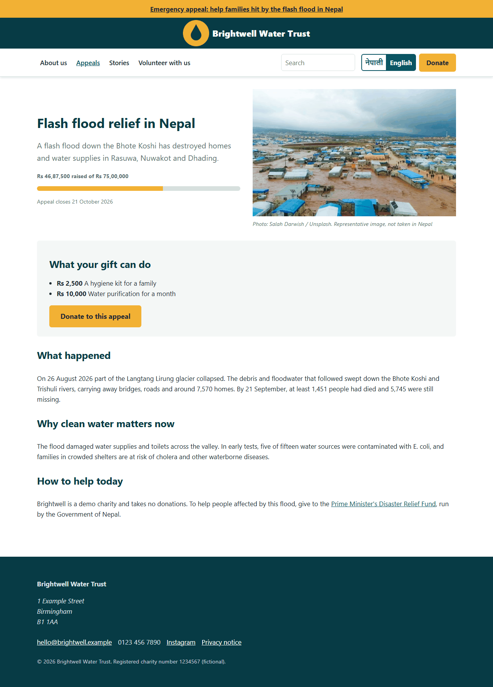
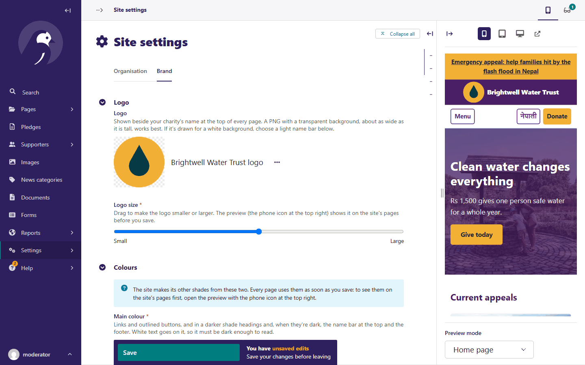

# The site

How each part of the site works: what it does for visitors and editors, why, the rules that
come with it, and where its code is. Start with the overview.

| An appeal | Previewing a brand change in Site settings |
|---|---|
|  |  |

```{toctree}
:maxdepth: 1

overview
standard
pages-and-content
appeals-and-giving
languages
images
look-and-feel
editors-and-permissions
```
